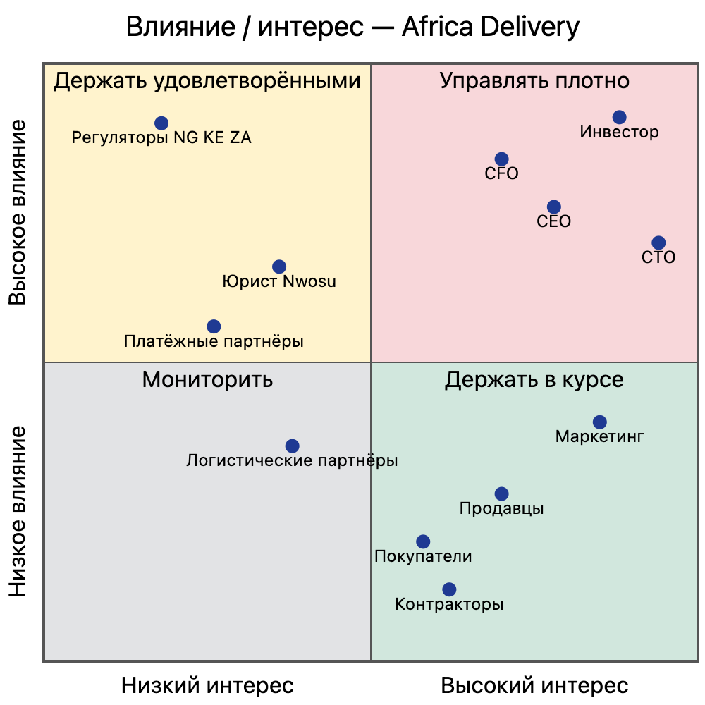

# Матрица стейкхолдеров

**Статус:** рабочая версия до встречи в Найроби

> **Источники А1–А8** — входные материалы проекта: А1 — [транскрипт kick-off с инвестором](../artifacts/artifact-01-investor-kickoff-transcript.md) · А2 — [маркетинговый бриф](../artifacts/artifact-02-marketing-brief.md) · А3 — [письмо юристов](../artifacts/artifact-03-legal-letter.md) · А4 — [список функций PM](../artifacts/artifact-04-pm-feature-list.md) · А5 — [письмо CTO](../artifacts/artifact-05-cto-email.md), А5.1 — [CN-чек-лист](../artifacts/artifact-05.1-cn-check-list.md) · А6 — [письмо CFO](../artifacts/artifact-06-cfo-email.md) · А7 — [записка инвестора](../artifacts/artifact-07-investor-note.md) · А8 — [схема системы от CTO](../artifacts/artifact-08-system-diagram.md). «п. N» — номер пункта, «…» в кавычках — раздел документа.

## Чей голос решающий

1. **Финальное слово за К. Орловым (инвестором).** Он единственный акционер и финансирует проект. Дата запуска и критерии успеха исходят от него (А1; А7).
2. **У CFO А. Вебер вето на бюджет.** Это право ей делегировал инвестор: «с Анной не спорь» (А1). Каждую позицию дороже $500/мес. она подписывает лично (А6 п. 2). Если архитектура не укладывается в бюджет, неверной считается архитектура (А6 п. 5).
3. **Регуляторные требования не обсуждаются.** NDPR, POPIA, DPA/KICA и лицензирование платежей — это граница допустимых решений (А3). Правом отменить их не обладает ни один внутренний стейкхолдер, включая инвестора.
4. Технические решения принимает CTO, но только в пределах бюджета CFO и регуляторных требований. Правило границы первого релиза задал инвестор: «всё, к чему прикасается покупатель, входит в первый релиз; бэк-офис подождёт» (А1). Конкретный объём в этих рамках определяет CEO: PM уволился, а вопрос о разделении релизов поднял именно CEO (А1).

## Матрица

Приоритет — порядок, в котором учитывается позиция стейкхолдера при конфликте: 1 — решающий голос, «огр.» — ограничение, которое действует вне голосования.

| Стейкхолдер | Ключевые интересы | Влияние | Интерес | Приоритет | Коммуникация |
|---|---|---|---|---|---|
| **К. Орлов**, инвестор, единственный акционер (ЛПР) | Запуск 15.10 без переноса; «не падает» ($12k/мин); данные остаются в стране; выплаты продавцам в тот же день; минимальная стоимость (А1, А7) | Высокое: финансирование, итоговое решение, связи с регуляторами | Высокий | **1** | Одна страница «решение + цифры + что нужно от вас», на английском. Синхронно, коротко, до его отъездов. Приходить с готовым решением, а не с проблемой (А1) |
| **Регуляторы** NDPC (NG), ODPC/CA (KE), Information Regulator (ZA) | Локализация ПДн, согласия, регистрация, DPO, ежегодный аудит (А3 п. 1–3) | Высокое: блокирующее (санкции, остановка) | Низкий, пока нет нарушений | **огр.** | Через юриста; ранний контакт с NDPC, как рекомендует юрист (А3 п. 1) |
| **А. Вебер**, CFO (ЛПР по бюджету) | ≤ $5k/мес. на инфраструктуру; без лицензий и предоплат; ≤ 2,5% GMV на платежи; 9 месяцев runway; стоимость заказа и TCO на 5 лет (А6) | Высокое: вето на бюджет; любая статья расходов дороже $500/мес. требует её предварительного письменного согласования (А6 п. 2) | Высокий | **2** | Письменно и заранее: TCO, стоимость заказа, коммерческое предложение с альтернативой по каждой позиции > $500 (А6 п. 2) |
| **М. Лефевр**, CEO (ЛПР по продукту и рынку) | Чёткая граница первого релиза (А1); опыт конкурента (Jumia); выполнение обещаний рекламы | Высокое: де-факто владелец продукта после ухода PM | Высокий | **3** | Еженедельный продуктовый синк и демо; решения по объёму фиксируются в roadmap |
| **Р. Менон**, CTO (техническое ЛПР) | 10M пользователей, CNCF, K8s, Istio, Kafka, Oracle, Go, build-not-buy, 99,99% (А5) | Высокое в технике, ограничено CFO | Очень высокий | **4** | Ежедневно 1:1; черновики ADR до встреч (А5); разговор на языке цифр TCO |
| **С. Алмейда**, Head of Marketing | Обещания из креативов, запуск 15.10, публикация в сторах 01.10, SMS по купленной базе, лайв-стрим 17.10 (А2) | Среднее: оплаченные $180k медиа задают сроки | Высокий | **5** | Еженедельно: статус готовности к запуску, перечень обещаний под риском |
| **А. Нвосу**, внешний юрист | Не отвечать за решения, принятые на основе предварительного письма (оговорка в конце А3); уберечь клиента от санкций регуляторов | Среднее, экспертное: детальное заключение по защите данных обещано через 4–6 недель и задаст окончательные ограничения; до него юрист советует не фиксировать архитектуру (А3) | Средний | 6 | Письменно, одним пакетом конкретных вопросов, а не созвонами (работа оплачивается почасово). Не ждать полного заключения: попросить за 1–2 недели подтвердить временную схему хранения (ПДн нигерийцев — в Нигерии, за рубеж — только псевдонимизированные данные, A-03) |
| **Платёжные партнёры**: Flutterwave, Paystack, M-Pesa | Объём транзакций, KYC/AML-соответствие мерчанта | Среднее: без них нет приёма платежей (А3 п. 4) | Низкий | 7 | Договоры, sandbox, технические созвоны по интеграции |
| **Логистические партнёры**: Sendbox, Sendy | Объём отправок, стабильность API | Среднее | Низкий | 8 | Договоры, API-интеграция, SLA доставки |
| **Продавцы** (МСБ, часть без интернета) | Деньги в тот же день, простой онбординг через WhatsApp/USSD (А1, А2) | Низкое по отдельности | Высокий | 9 | Пилотные интервью с 10–15 продавцами в Лагосе, канал WhatsApp |
| **Покупатели** (22–40 лет, Android < $150, 3G/4G) | Цена, доверие, экономия трафика, оплата через M-Pesa (А2) | Низкое по отдельности | Средний | 10 | Продуктовая аналитика, отзывы в сторах |
| **6 контракторов** | Реалистичный объём, понятная архитектура, посильное дежурство (А6 п. 5) | Низкое | Средний | 11 | Ежедневный стендап, ADR в репозитории |
| Т. Брэдли, бывший PM | — (уволился 04.08) | Нет | Нет | — | Не участвует; его список (А4) — входные данные, а не утверждённый объём |

## Диаграмма «Влияние / интерес»

Исходник: [stakeholder-influence-interest.mmd](diagrams/stakeholder-influence-interest.mmd).

## Assumptions

- CEO отвечает за объём MVP до найма нового продакт-менеджера. Явно это никто не назначал: допущение основано на уходе PM и на том, что CEO сам поднял вопрос о границе релиза (А1). Подлежит подтверждению (см. [open-questions.md](open-questions.md), Q-03).
- С регуляторами взаимодействуем только через юриста или инвестора. Прямого канала у технической команды нет.
