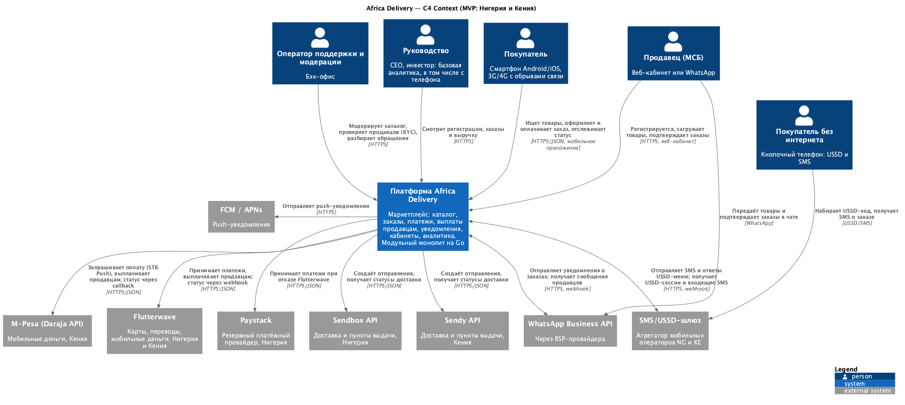

# Architecture Vision — Africa Delivery

**Версия:** 1.0  
**Дата:** 2026-08-18  
**Статус:** на утверждение (встреча в Найроби)

> C-xx — [реестр противоречий](../Task1/contradictions.md), A-xx — [допущения Canvas](../Task1/architecture-canvas.md#assumptions), Q-xx — [открытые вопросы](../Task1/open-questions.md). Источники А1–А8 — [входные материалы](../artifacts/README.md).

## 1. Введение

**Цель документа.** Зафиксировать архитектуру, с которой Africa Delivery запускается 15.10 в Нигерии и Кении, и путь к платформе на 5+ стран без переписывания.

**Область применения.** Мобильное приложение покупателя, каналы USSD/SMS и WhatsApp, кабинеты продавца и бэк-офиса, серверная платформа, интеграции с партнёрами. Собственная логистика, склады и B2B в MVP не входят.

**Глоссарий.** *GMV* — оборот товаров. *ПВЗ* — пункт выдачи заказов. *ПДн* — персональные данные. *BSP* — провайдер WhatsApp Business API. *FCM / APNs* — сервисы доставки push-уведомлений: Firebase Cloud Messaging (Google, Android) и Apple Push Notification service (Apple, iOS). *Модуль* — часть монолита со своей схемой БД и публичным интерфейсом. Основные объекты: покупатель, продавец, товар, заказ, платёж, выплата, отправление, согласие.

## 2. Бизнес-контекст и цели

| Горизонт | Цель | Критерий успеха |
|---|---|---|
| 15.10.2026 (MVP) | Пять целей запуска: каталог на 5000 SKU от 100 продавцов; заказ с оплатой через M-Pesa и Flutterwave; уведомления по SMS и в мессенджерах; кабинет покупателя; базовая аналитика | «Люди покупают, продавцы получают деньги, ничего не ломается, данные не за рубежом» (А1) |
| 12 месяцев | 5 стран, B2B, 1M+ пользователей, кабинет продавца, track & trace, возвраты, языки | Рост без переписывания MVP |
| 3 года | 12–15 стран, 40% рынка (А1, А7) | Новая страна подключается конфигурацией |

**Стейкхолдеры** ([матрица](../Task1/stakeholder-matrix.md)): финальное слово — у инвестора; вето на бюджет — у CFO; объём MVP — за CEO; технические стандарты — за CTO; границу допустимого задают регуляторы (NDPC, ODPC, Information Regulator).

**Стратегические драйверы:** срок 15.10 (А1, А2); ≤ \$5k/мес и 6 контракторов (А6); локализация ПДн и согласия (А3); 3G/4G с обрывами и Android дешевле \$150 (А2); цена простоя (А1); Cloud Native и переносимость (А5, А5.1). Заключение юристов придёт через 4–6 недель (А3), поэтому решение о размещении данных принимается отдельно и сделано обратимым (C-03).

## 3. Текущее состояние

Это greenfield: систем, данных и команды эксплуатации нет. Ограничения рынка: у AWS, Google Cloud и Azure нет полноценного региона в Нигерии; 30–40% аудитории без стабильного интернета (А2); нет адресной системы, поэтому доставка идёт в ПВЗ партнёров; требования продавцов не проверены (R-4).

## 4. Целевое состояние

Исходник: [c4-context.puml](c4-context.puml). Сценарии MVP: [use-cases.png](use-cases.png) ([исходник](use-cases.puml)).

**Ключевые компоненты.** Модульный монолит на Go и фоновый воркер ([ADR-001](adr-001-architecture-style.md)):

| Модуль | Ответственность | Выделение в сервис |
|---|---|---|
| Каталог и поиск | Товары, категории, поиск, фото через CDN | Первым, 2-й год |
| Заказы | Корзина, оформление, статусы, резерв остатков | 3-й год |
| Платежи и выплаты | Фасад M-Pesa / Flutterwave / Paystack, выплаты в день доставки, сверка | По требованиям лицензий |
| Уведомления и каналы | Push, SMS, WhatsApp, USSD-меню; выбор канала по стоимости | 2-й год |
| Продавцы, доставка | Онбординг (веб, WhatsApp), KYC; адаптеры Sendbox и Sendy, ПВЗ | По Build/Buy-расчёту |
| Идентификация и согласия | Вход по OTP, журнал согласий, PII-хранилище по странам | — |
| Аналитика | Базовая аналитика для CEO: регистрации, заказы, выручка, обновление раз в час; инвестор открывает тот же отчёт с телефона | Перенос в DWH через 6 мес. |

**Клиенты:** приложение на React Native с локальным кешем каталога и офлайн-очередью, диплинки на карточку товара (А2); веб-кабинет продавца и бэк-офис на TypeScript.

**Интеграции:** партнёры подключаются только через адаптеры (anti-corruption layer) — таймауты, повторы, circuit breaker, идемпотентные webhook. Модули обмениваются событиями через transactional outbox и очередь.

**Платформа:** managed Kubernetes и PostgreSQL Multi-AZ в одном регионе с 3 зонами доступности, DR-реплика, CDN. ПДн граждан Нигерии хранятся в изолированном хранилище в Нигерии (A-03); провайдер выбирается после сравнения облачных регионов.

## 5. Архитектурные принципы и ограничения

1. **Срок и бюджет — ограничения.** Решение, которое не помещается в 15.10, \$5k/мес и 6 человек, неверно (А6 п. 5).
2. **Late binding:** дорогие решения принимаются по измеримому триггеру (раздел 7).
3. **Интегрировать, а не строить:** платежи, доставка и сообщения — через лицензированных партнёров (А3 п. 4; C-05).
4. **Mobile-first и offline-first:** кеш в приложении, экономия трафика, USSD/SMS — полноценный канал.
5. **Privacy by design:** ПДн хранятся по стране субъекта, маркетинг — только с согласия (C-07).
6. **Переносимость через открытые стандарты:** Kubernetes API, PostgreSQL, OpenTelemetry, Terraform (C-06).
7. **Страна — это конфигурация:** валюта, язык, провайдеры, правила данных.

**Ограничения:** без коммерческих лицензий и предоплат (А6 п. 3, 7); позиции дороже \$500/мес — с согласия CFO; платежи — только через лицензированного партнёра (А3 п. 4).

**Стандарты:** Go, TypeScript, React Native, PostgreSQL, REST/JSON и webhook. CN-чек-лист (А5.1) выполняется полностью: контейнеры, requests/limits, ≥ 2 реплики, пробы, GitOps (ArgoCD), секреты, OpenTelemetry. Исключение — CN.LCP.03, он выполняется частично до выделения сервисов.

## 6. Нефункциональные требования

Приоритет при конфликте: **закон и защита данных → доступность оплаты → производительность → стоимость.**

| Атрибут | Цель MVP |
|---|---|
| Доступность | Оформление и оплата 99,95%, каталог 99,9% с деградацией на кеше, бэк-офис 99,5% (A-02) |
| Производительность | Первый товар на экране < 2 с на 3G (А2); P99 API каталога < 500 мс |
| Масштабируемость | Пик запуска 10× от средней нагрузки; до 1–3M пользователей без смены стиля |
| Восстановление | RTO ≤ 4 ч, RPO ≤ 5 мин |
| Безопасность | OTP-вход, RBAC, шифрование при передаче и хранении, платёжные реквизиты только как токены провайдера |

Детализация — в реестре НФТ, SLO-контрактах по сервисам и стратегии доступности.

## 7. Дорожная карта реализации

| Этап | Срок | Содержание |
|---|---|---|
| Фундамент | до 01.09 | Платформа, CI/CD, каталог, идентификация, адаптеры платежей в sandbox |
| Бета | до 01.10 | Заказ, оплата, уведомления, USSD, кабинет продавца; приложение в сторах, нагрузочный тест |
| MVP | 15.10 | Запуск в Нигерии и Кении, 100 продавцов |
| 6 месяцев | апрель 2027 | Track & trace, возвраты, кабинет продавца с аналитикой, ЮАР |
| 12 месяцев | октябрь 2027 | 5 стран, B2B, выделение каталога и уведомлений, языки |

**Что сознательно не делаем и до какого момента (late binding):**

| Не делаем сейчас | Триггер пересмотра |
|---|---|
| Микросервисы | > 2 000 RPS на каталог, > 3 команд или > 2 конфликтов релизов в неделю |
| Kafka, Istio | > 5 потребителей одного события или > 10 сервисов |
| Выделенные USSD-коды в Кении (~\$1 790/мес) | > ~18 тыс. USSD-заказов в месяц (≈ 2-й год); до этого — общий код агрегатора ([price-list.md](supporting/price-list.md), P-27) |
| Active-active между регионами | Минута простоя > \$2 500 (≈ 3-й год) |
| Своя логистика и платёжная оркестрация | Build/Buy-расчёт в roadmap; адаптеры позволяют сменить партнёра |
| Oracle, СУБД и брокеры в собственной эксплуатации | Не планируется |
| Живой дашборд с обновлением раз в минуту (пожелание: А2; А4 № 28) | Если часового отчёта не хватит для решений во время распродаж; делается на реплике чтения без смены архитектуры |
| Токенная программа лояльности (А1; А5) | Исследование после MVP, оценка к апрелю 2027 |
| Окончательная схема размещения данных | Заключение юристов (сентябрь) |

**Анализ разрыва:** API партнёров, managed-сервисы и опыт CTO в Go готовы к использованию. Не хватает договоров с партнёрами и нигерийским провайдером, закупки облака по счёту и исследования продавцов.

## 8. Риски и допущения

| Риск | Мера |
|---|---|
| Закупка облака по счёту займёт до 3 недель (А6 п. 4) | Запустить на первой неделе параллельно с разработкой |
| Отказ платёжного партнёра в пике | Второй провайдер на страну, circuit breaker, оплата при получении |
| Заключение юристов изменит требования к данным | Резидентность ПДн задаётся политикой страны в конфигурации |
| Пик трафика после рекламы (А2) | Нагрузочный тест к 01.10, кеш, очередь на оформление заказа |
| Устойчивость Sendy в Кении не подтверждена ([price-list.md](supporting/price-list.md), P-36) | Доставка через адаптер: запасной курьерский партнёр подключается без изменений в модуле доставки |

**Допущения:** 1M пользователей к 12-му месяцу и 10M к 5-му году (A-01); SLO по сервисам (A-02; Q-01); ПДн граждан Нигерии хранятся в Нигерии (A-03); платежи и логистика — через партнёров (A-04); только managed-сервисы на открытом ПО (A-05); расходы на сообщения не входят в \$5k (A-09; Q-02). Цифры — в [tco-model.xlsx](tco-model.xlsx) и [options-comparison.md](options-comparison.md), цены и их источники — в [price-list.md](supporting/price-list.md).
