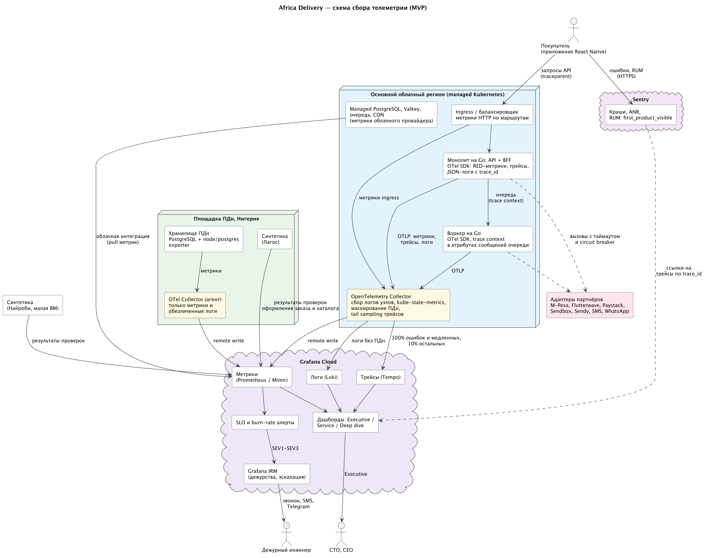

# Стратегия наблюдаемости

> Источники: А5 — письмо CTO, А5.1 — CN-чек-лист, А3 — письмо юристов, А6 — письмо CFO ([входные материалы](../artifacts/README.md)). SLI — [slo/](slo/); НФТ — [nfr-registry.md](nfr-registry.md); цены — [price-list.md](../Task2/supporting/price-list.md), P-17, P-20.

## Принципы

1. **Сначала SLI, потом графики.** Каждый алерт, по которому будят дежурного, привязан к SLI или к угрозе SLI. Загрузка CPU сама по себе не инцидент.
2. **Метрики → трейсы → логи.** Алерт приходит по метрике, место сбоя ищут по трейсу, причину — в логах по `trace_id`.
3. **Один стандарт — OpenTelemetry.** Те же открытые форматы, что предлагал CTO (А5: OTel, Prometheus, Grafana, Loki), только в managed-варианте. Перенос в собственный стек — смена адреса экспорта в Collector, без изменения кода (NFR-16).
4. **Без ПДн и без высокой кардинальности.** Телефоны, имена и адреса маскируются в Collector до отправки (А3 п. 1, NFR-17). В метках метрик нельзя использовать `user_id`, `order_id`, телефон; разрешены `route`, `status`, `module`, `country`, `partner`, `channel`.

## Четыре золотых сигнала

| Сервис | Latency | Traffic | Errors | Saturation |
|---|---|---|---|---|
| **Каталог и поиск** | P95/P99 `http_server_request_duration_seconds{route=~"catalog\|search"}`; RUM `first_product_visible` P90 | RPS по маршрутам; доля попаданий в CDN и Valkey | Доля 5xx; ошибки клиента кеша | CPU/RAM подов относительно limits; запас автомасштабирования: текущие реплики ÷ максимум HPA; пул БД каталога; память и вытеснения Valkey |
| **Оформление заказа и платежи** | P99 `POST /orders`, `/payments`; P99 `partner_request_duration_seconds{partner}`; время до финального статуса платежа | Заказы/мин и инициации платежей/мин по стране и провайдеру | Доля 5xx; технические ошибки провайдера; `payment_pending_age_seconds` > 10 мин; состояние circuit breaker | Пул БД оформления заказа; ожидание блокировок при резерве остатков; отказы rate limiting |
| **Уведомления** | P99 `notification_handoff_seconds{channel}` | Сообщений/мин по каналу и типу (OTP, транзакционные, маркетинг) | Ошибки провайдера канала; доля fallback на следующий канал | Глубина очереди и возраст старейшего сообщения; использование квот провайдеров; занятость воркеров |
| **Платформа** | Задержка запросов PostgreSQL, P99 | IOPS, сетевой трафик | Перезапуски подов, ошибки репликации | Соединения БД; `replication_lag_seconds` (standby, DR, площадка ПДн в Нигерии); CPU и RAM узлов; диск |

Метрики приложений собираются по RED (rate, errors, duration), ресурсы — по USE (utilization, saturation, errors).

## Связь метрик с SLI

| SLI | Успешные события (числитель) | Все учитываемые события (знаменатель) | Источник |
|---|---|---|---|
| PAY-SLI-1 | `rate(http_server_request_duration_seconds_count{route=~"orders\|payments", status!~"5.."}[5m])` | То же без 4xx | Ingress и OTel SDK |
| PAY-SLI-3 | `rate(payment_finalized_total{within="5m"}[5m])` | `rate(payment_initiated_total[5m])` | Модуль платежей |
| CAT-SLI-1 / CAT-SLI-2 | Запросы каталога без 5xx / с ответом ≤ 500 мс (бакет гистограммы `le="0.5"`) | Все запросы каталога без 4xx | Ingress и OTel SDK |
| CAT-SLI-3 | Холодные запуски с `first_product_visible` ≤ 2 с | Все холодные запуски на поддерживаемых устройствах | Sentry |
| NOT-SLI-1 | `notification_handoff_seconds_bucket{le="60", type!="marketing"}` | `notification_handoff_seconds_count{type!="marketing"}` | Воркер уведомлений |

SLO и burn-rate алерты описываются в Grafana SLO в виде кода (Terraform) и хранятся в Git вместе с контрактами из [slo/](slo/).

## Метрики, логи, трейсы

| Вид телеметрии | Как собираем | Объём и хранение |
|---|---|---|
| Метрики | OTel SDK в Go (HTTP, pgx, клиент Valkey, адаптеры партнёров) → OTel Collector → Prometheus remote write. Метрики managed-сервисов — через облачную интеграцию Grafana Cloud | Интервал 15 с; ≤ 10 тыс. активных серий; хранение 13 мес. |
| Логи | Структурированный JSON в stdout: `trace_id`, `module`, `country`, `order_id`. Collector собирает логи с узлов, маскирует ПДн и отправляет в Loki | 100% ERROR и WARN, 10% INFO по успешным запросам; ≤ 50 ГБ/мес; 30 дней. Аудит платежей хранится в БД, а не в логах |
| Трейсы | OTel SDK; приложение передаёт `traceparent`. Через очередь и outbox контекст передаётся в атрибутах сообщения, иначе цепочка рвётся. Callback партнёра начинает новый трейс со ссылкой (span link) по `payment_id` | Tail sampling в Collector: 100% ошибок и запросов > 1 с, 10% остальных; 30 дней |
| Мобильное приложение | Sentry: краши, ANR, span `first_product_visible`; связь с бэкендом — по `trace_id` | Тариф Sentry Team (P-20): объём и срок хранения — в пределах квот тарифа |
| Синтетика (синтетический мониторинг) | Агенты Grafana Synthetic Monitoring в Лагосе (на площадке ПДн) и в Найроби (малая ВМ) проверяют каталог и поиск раз в минуту, оформление заказа — раз в 5 мин в тестовом режиме провайдера | 2 точки × 3 сценария; ≈ 0,4 RPS, < 0,05% пиковой нагрузки; 576 тестовых заказов в сутки |

**Синтетика** (синтетический мониторинг) — автоматический скрипт, который регулярно проходит путь покупателя: открывает каталог, ищет товар, открывает карточку, оформляет тестовый заказ в тестовом режиме платёжного провайдера. Скрипт запускается из города, где живут покупатели, поэтому проверяет тот же путь, что и реальный запрос: местный интернет, CDN, балансировщик, облачный регион. Он обнаруживает сбой даже ночью, когда реальных покупателей почти нет, и видит отказ сети между страной и облаком, который не заметен по метрикам сервера: если запросы до сервера не доходят, сервер ошибок не фиксирует.

Синтетика изолирована от реальных покупателей: работает с тестовым продавцом и тестовыми SKU и не резервирует реальные остатки, в том числе во время флеш-распродаж. Запросы помечены заголовком, поэтому не попадают в аналитику, выручку и выплаты. Тестовые заказы удаляются автоматически.

**Схема сбора** (исходник — [observability.puml](diagrams/observability.puml)):

## Что считается инцидентом

| Уровень | Критерий | Реакция | Кого информируют |
|---|---|---|---|
| SEV1 | Быстрое сгорание бюджета (×14,4 за 1 ч) PAY-SLI-1 или CAT-SLI-1; синтетика каталога падает в обоих городах 3 проверки подряд (3 мин) или синтетика оформления заказа — 2 проверки подряд (10 мин); сбой OTP; подозрение на утечку ПДн или потерю данных | Звонок дежурному, подтверждение ≤ 5 мин, круглосуточно | CTO через 15 мин; CEO и инвестор — если простой > 15 мин |
| SEV2 | Медленное сгорание бюджета (×6 за 6 ч); circuit breaker партнёра открыт > 5 мин; возраст очереди уведомлений > 30 с | Звонок, подтверждение ≤ 30 мин | CTO в отчёте за смену |
| SEV3 | Сгорание ×1 за 3 дня; попаданий в кеш < 80%; пул БД > 80%; реплики HPA > 80% от максимума дольше 15 мин; отставание реплики > 60 с | Задача в рабочее время | — |
| Не инцидент | Рост CPU или памяти без влияния на SLI | Наблюдение, автомасштабирование | — |

После каждого SEV1 и SEV2 пишется blameless postmortem с причиной по методу «5 почему» и архитектурными действиями. Если бюджет ошибок исчерпан, действует политика из SLO-контрактов: релизы функций модуля замораживаются.

**Автомасштабирование по бизнес-метрикам:** API масштабируется по RPS на под, воркер — по возрасту сообщений в очереди, а не по CPU. Если воркер ждёт ответа медленного партнёра, процессор у него свободен, а очередь при этом растёт.

## Дашборды по слоям

| Слой | Для кого | Что показывает |
|---|---|---|
| Executive | CEO, CTO, инвестор (с телефона) | Статус SLO и остаток бюджета ошибок по трём сервисам; заказы и платежи в минуту; оценка потерь от простоя (минуты × \$/мин) |
| Service | Дежурный, CTO | Четыре золотых сигнала по сервисам, состояние партнёров и circuit breaker, очереди |
| Deep dive | DevOps, разработчики | PostgreSQL, Valkey, узлы K8s, трейсы и логи |

## Инструменты и стоимость

| Инструмент | Назначение | \$/мес |
|---|---|---|
| OpenTelemetry SDK и Collector | Инструментирование, сбор, маскирование ПДн, сэмплирование | 0 (open source) |
| Grafana Cloud Pro: Prometheus/Mimir, Loki, Tempo, SLO, Synthetic Monitoring, IRM | Хранение, дашборды, SLO, алерты, дежурства | ≈ 230–250 (P-17) |
| Sentry Team | Мобильные краши и RUM | 26 (P-20) |
| ВМ для синтетики в Найроби | Синтетика | ≈ 5 |
| **Итого** | | **≈ \$260–280** (NFR-18: ≤ \$300) |

Мониторинг размещён вне нашего облачного региона, поэтому он не падает вместе с продом. Это важно для QAS-05. Из платформы уходит только телеметрия без ПДн.

## Assumptions

- Лимиты Grafana Cloud Pro (10 тыс. серий, 50 ГБ логов и 50 ГБ трейсов включены в тариф) хватают на объём MVP. При превышении стоимость растёт на \$6,5 за 1 тыс. серий и около \$0,55 за ГБ (P-17).
- Телеметрия без ПДн может храниться за пределами Нигерии. Это следует из допущения, что за рубеж уходят только обезличенные данные (A-03); подтверждается заключением юристов.
