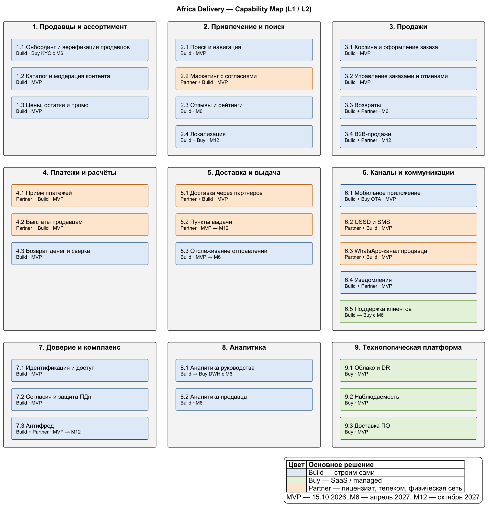

# Capability Map — Africa Delivery

**Дата:** 2026-08-31 · **Статус:** Предложено

> А1–А8 — [входные материалы](../artifacts/README.md), C-xx — [противоречия](../Task1/contradictions.md), P-xx — [price-list.md](../Task2/supporting/price-list.md). Этапы: MVP — 15.10.2026, M6 — апрель 2027, M12 — октябрь 2027. 1 чел.-нед. ≈ \$1,3k.

## Иерархия L1 / L2

Исходник: [capability-map.puml](diagrams/capability-map.puml).

## Решения по возможностям

| Capability (L2) | Решение | Обоснование | Стоимость | Риск |
|---|---|---|---|---|
| 1.1 Онбординг и верификация продавцов | **Build**, KYC — **Buy** с M6 | Регистрация, договор и загрузка товаров через веб и WhatsApp — свои. 100 продавцов MVP проверяет оператор вручную; с M6 — KYC-сервис (Smile ID) | MVP 4 чел.-нед. (\$5k); M6 ≈ \$0,5–1 за проверку | Ручной KYC не выдержит > ~300 продавцов в месяц |
| 1.2 Каталог и модерация контента | **Build** (MVP) | «Проверено» — основа доверия (А2); удаление контента по требованию регулятора — наша ответственность (А3 п. 3, 5) | 7 чел.-нед.: каталог 4, бэк-офис 3 (\$9k) | Контрафакт до модерации — проверка до публикации |
| 1.3 Цены, остатки и промо | **Build** (MVP) | Резерв остатка — транзакция PostgreSQL; флеш-распродажа с таймером обещана в рекламе (А2) | 1 чел.-нед. в составе 3.1 | Перепродажа остатка в пике — NFR-08 |
| 2.1 Поиск и навигация | **Build** на PostgreSQL FTS (MVP) | 5 000 SKU помещаются в FTS и триграммы; отдельный движок — по триггеру ADR-002 (> 50 тыс. SKU) | Входит в 1.2; движок ≈ \$100–200/мес после триггера | До M12 поиск только на английском |
| 2.2 Маркетинг с согласиями | **Partner** (TikTok и Facebook Live) + **Build** диплинки и проверка согласия (MVP) | Лайв на внешних площадках закрывает обещание А2 без своего стриминга; рассылки только по согласию (C-07) | \$0; свой live-commerce (≈ 8–10 чел.-нед.) не делаем | Блогеры уводят трафик с площадки — диплинк на карточку |
| 2.3 Отзывы и рейтинги | **Build** (M6) | Отзыв только по полученному заказу — часть доверия | 3 чел.-нед. | Накрутка — отзывы только от покупателей |
| 2.4 Локализация | **Build** i18n + **Buy** Crowdin и переводчики (M12) | Каркас i18n с MVP; 5 языков из креативов (А2) — к M12 | ≈ \$60/мес + ≈ \$12k переводы | Качество перевода — только профессиональные переводчики |
| 3.1 Корзина и оформление заказа | **Build** (MVP) | Офлайн-корзина, оформление без ожидания провайдера (NFR-06) | 3 чел.-нед. (\$4k) | — |
| 3.2 Управление заказами и отменами | **Build** (MVP) | Статусы, отмена с возвратом денег до отправки | Входит в 3.1 | — |
| 3.3 Возвраты | **Build** + **Partner** обратная доставка (M6) | 30 дней из рекламы (А2); деньги — при приёмке в пункте выдачи | 4 чел.-нед. | Злоупотребления возвратами — 7.3 |
| 3.4 B2B-продажи | **Build** цены и счета; **Partner** отсрочка платежа (M12) | Отсрочка 30 дней (А4 № 22) — это кредит, нужен лицензированный партнёр | 8 чел.-нед. | Кредитный риск — на партнёре |
| 4.1 Приём платежей | **Partner** + **Build** платёжный фасад (MVP) | Лицензия к сроку нереальна (А3 п. 4, C-05). NG — Flutterwave + Paystack, KE — M-Pesa напрямую ([ADR-004](adr-004-payment-provider.md)) | ≈ 1,97% GMV (≈ \$520k в Год 1); фасад 3 чел.-нед. | Ставка > 2,5% при сдвиге к картам — маршрутизация |
| 4.2 Выплаты продавцам | **Partner** (M-Pesa B2C, Flutterwave Transfers) + **Build** правила (MVP) | Деньги в день доставки — обещание продавцу (А7) | ≈ 0,15% GMV; 1 чел.-нед. | Окно выплат провайдера — PAY-SLI-4 |
| 4.3 Возврат денег и сверка | **Build** (MVP) | Ежедневная сверка, 0 двойных списаний (FMEA F-01) | 1 чел.-нед. | — |
| 5.1 Доставка через партнёров | **Partner** (Sendbox, Sendy) + **Build** адаптер (MVP) | Свой логистический движок (А5) не помещается в срок и команду (C-04); адаптер позволит подключить его позже | \$0,10/заказ (\$120k в Год 1); адаптер 2 чел.-нед. | Sendy неустойчив (P-36) — второй курьер в KE |
| 5.2 Пункты выдачи | **Partner** — сети Sendbox и Sendy (MVP); видеофиксация — M12 | Адресной системы нет — выдача в пунктах партнёров. Видеофиксация — после заключения юристов (А4) | Входит в 5.1; видео хранит партнёр | Видеофиксация может оказаться незаконной |
| 5.3 Отслеживание отправлений | **Build** поверх статусов партнёров (MVP → M6) | MVP — статусы заказа; M6 — полный track & trace (цель 12 мес.) | 3 чел.-нед. в M6 | Качество webhook партнёров |
| 6.1 Мобильное приложение | **Build** (React Native) + **Buy** OTA (Expo EAS) (MVP) | Кеш каталога, офлайн, < 2 с до первого товара (А2) | 7 чел.-нед.; EAS \$199/мес | Ревью в сторах — сдать до 20.09 |
| 6.2 USSD и SMS | **Partner** (Africa's Talking + Termii) + **Build** USSD-меню (MVP) | 30–40% аудитории без интернета (А2) | 3 чел.-нед. на 6.2–6.4; SMS ≈ \$0,005; USSD-сессия KE \$0,0096 | Блокировка маршрута — второй SMS-маршрут |
| 6.3 WhatsApp-канал продавца | **Partner** (360dialog) + **Build** сценарии (MVP) | Продавцы работают в мессенджере (кейс) | \$59/номер; \$0,004–0,0067/сообщение | Meta отклоняет шаблон сообщения или переводит его в маркетинговую категорию — шаблоны на одобрение до 15.09, резервный канал SMS |
| 6.4 Уведомления | **Build** оркестрация + **Partner** каналы (MVP) | Fallback push → WhatsApp → SMS по цене канала (NFR-03) | В 6.2–6.3; push бесплатно | — |
| 6.5 Поддержка клиентов | **Build** в бэк-офисе (MVP) → **Buy** Freshdesk (M6) | В MVP обращения разбирает оператор в бэк-офисе | ≈ \$15–19/агент/мес | — |
| 7.1 Идентификация и доступ | **Build** OTP (MVP) | Auth0 и Firebase Auth хранят телефоны вне Нигерии — нарушает локализацию ПДн (А3 п. 1) | 3 чел.-нед. вместе с 7.2 | SMS-фрод с OTP — лимиты отправки |
| 7.2 Согласия и защита ПДн | **Build** (MVP) | Журнал согласий (А3 п. 2), PII-хранилище NG ([ADR-003](../Task4/adr-003-data-residency.md)) | Узел NG ≈ \$320/мес | Заключение юристов — меняется политика страны |
| 7.3 Антифрод | **Build** правила + **Partner** средства провайдеров (MVP); ML — по триггеру | В MVP хватает правил и антифрода Flutterwave и Paystack; для ML нужны данные | 1 чел.-нед. в 4.1 | Фрод с возвратами — 3.3 |
| 8.1 Аналитика руководства | **Build** дашборд в Grafana (MVP) → **Buy** BigQuery (M6) | Grafana уже оплачена; DWH — когда отчёты начнут нагружать реплику | 2 чел.-нед.; BigQuery ≈ \$100/мес | — |
| 8.2 Аналитика продавца | **Build** на DWH (M6) | Цель 12 мес.: кабинет продавца с аналитикой | 4 чел.-нед. | — |
| 9.1 Облако и DR | **Buy** managed — GCP, AWS, Layer3 (MVP) | ADR-001, ADR-003 | ≈ \$1 900/мес | Закупка по счёту — R-04 |
| 9.2 Наблюдаемость | **Buy** Grafana Cloud, Sentry (MVP) | Свой стек на 6 человек не держим (А6 п. 5) | ≈ \$270/мес | — |
| 9.3 Доставка ПО | **Buy** GitHub + ArgoCD (open source) (MVP) | GitOps из CN-чек-листа (А5.1) | ≈ \$110/мес; платформа 8 чел.-нед. DevOps | — |

## Правило выбора Build / Buy / Partner

- **Build** — возможность отличает нас от конкурентов (доверие, цена, выплаты в тот же день, работа без интернета) или её нельзя отдать вендору из-за локализации ПДн (А3 п. 1).
- **Buy** — типовая функция, которую SaaS или managed-сервис закрывает дешевле одной чел.-недели в месяц.
- **Partner** — нужна лицензия (платежи, кредит, e-money; А3 п. 4), телеком-доступ (SMS, USSD, WhatsApp) или физическая сеть (курьеры, пункты выдачи).

Если у возможности есть и своя часть, и чужая, указаны оба решения: например, **Partner** + **Build** — приём платежей у лицензиата, а платёжный фасад наш.
