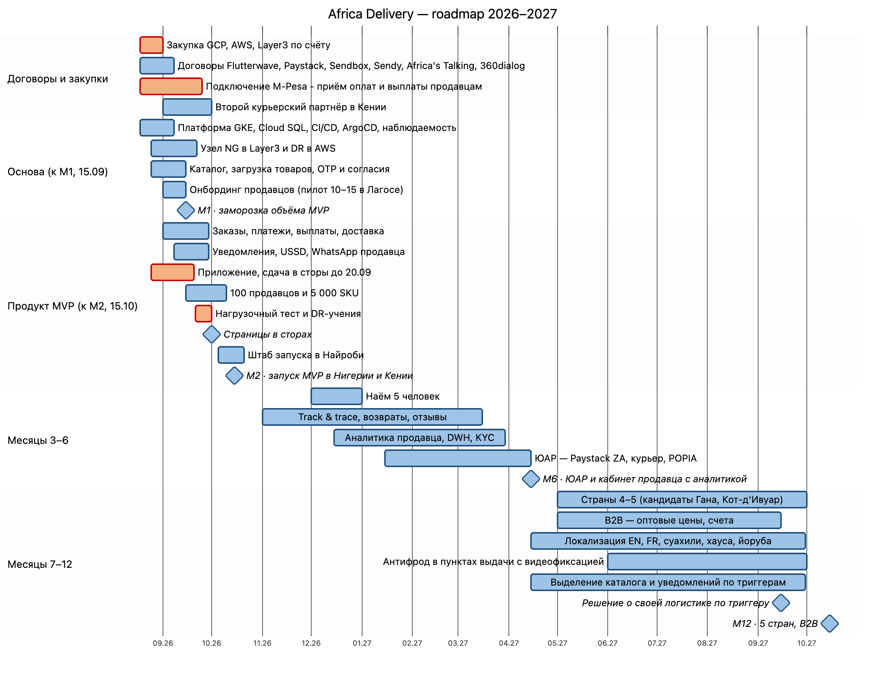

# MVP Roadmap — Africa Delivery

**Дата:** 2026-08-31 · **Статус:** Предложено (объём MVP утверждает CEO, Q-03)

> Источники А1–А8 — [входные материалы](../artifacts/README.md). C-xx — [противоречия](../Task1/contradictions.md), Q-xx — [открытые вопросы](../Task1/open-questions.md). Возможности — [capability-map.md](capability-map.md), архитектура по этапам — [transition-architecture.md](transition-architecture.md), риски R-xx — [risk-register.md](risk-register.md), команда — [team-structure.md](team-structure.md). Стоимость — [tco-model.xlsx](../Task2/tco-model.xlsx), [cloud-regions-comparison.md](../Task4/cloud-regions-comparison.md).

**Коротко:** из 29 функций PM в MVP целиком входят 2, в урезанном виде — 12. Ещё 2 функции переносятся на M6/M12 по целям бизнеса, 7 — на период после 12 месяцев, 6 вычеркнуты. MVP занимает 44 из 48 чел.-нед. ёмкости. Облако и SaaS растут с \$1,2k до \$4,5k в месяц и остаются в пределах \$5k.

## Gantt

Исходник - [roadmap.mmd](diagrams/roadmap.mmd)

## Контрольные точки

| | M1 — 15.09.2026 | M2 — MVP, 15.10.2026 | M6 — 15.04.2027 | M12 — 15.10.2027 |
|---|---|---|---|---|
| **Scope** | Договоры и закупка облака по счёту. Платформа, CI/CD, наблюдаемость. Каталог, загрузка товаров, OTP и согласия. Платежи в sandbox. Пилот с 10–15 продавцами. **Заморозка объёма MVP** | Нигерия и Кения: каталог на 5 000 SKU от 100 продавцов; заказ с оплатой M-Pesa и Flutterwave (Paystack в резерве); выплаты в день доставки; push, WhatsApp, SMS; USSD-заказ; кабинет покупателя; флеш-распродажа; базовая аналитика для CEO. Приложение в сторах с 01.10 | ЮАР. Полный track & trace, возвраты 30 дней, отзывы, наличные при получении. Кабинет продавца с аналитикой, DWH, KYC-сервис, helpdesk | 5 стран (4–5 — по решению CEO, кандидаты — Гана и Кот-д'Ивуар). B2B. Антифрод в пунктах выдачи. Языки EN и FR + суахили, хауса, йоруба. Каталог и уведомления выделены в сервисы по триггерам ADR-001. Решение о своей логистике |
| **Команда** | 6 контракторов (3 Go, 1 React Native, 1 TypeScript, 1 DevOps) + CTO и архитектор | То же; штаб запуска в Найроби 05.10–20.10 | 11: +5 наймов с декабря (PM, Go, мобильный разработчик, QA, data engineer); локальные роли поддержки и работы с продавцами в Лагосе и Найроби | 11 + CTO и архитектор; дежурство follow-the-sun по 3 окнам |
| **Облако + SaaS, \$/мес** | ≈ 1 200 (стенды, прод без нагрузки) | ≈ 2 750 (облако ≈ 1 900 по ADR-003 + SaaS ≈ 850) | ≈ 3 600 (рост нагрузки, BigQuery, Freshdesk) | ≈ 4 500 (12-й месяц по TCO) |
| **Стоимость заказа** | — | \$3,54 (TCO) | — | \$1,12 (TCO) |

Сообщения, комиссии и сборы логистики не входят в потолок \$5k (A-09): ≈ \$0,56 на заказ при ставке ≈ 1,97% GMV и среднем чеке \$22 (TCO) ([ADR-004](adr-004-payment-provider.md)).

## Что стало со списком PM (29 функций)

**Критерии попадания в MVP:**
- **К1** — без функции невозможен оплаченный заказ или выплата продавцу, то есть одна из пяти целей MVP (кейс, «Цели бизнеса»).
- **К2** — функцию требует закон (А3).
- **К3** — функция обещана в уже оплаченной рекламе (А2), обходного пути нет, а стоит она ≤ 1 чел.-нед.

Если функция не проходит ни один критерий, она переносится на период, к которому её требуют цели бизнеса (**Ц12** — цели на 12 месяцев), на период после 12 месяцев или вычёркивается: если нужна лицензия, есть юридический риск или нет цели.

**Нет цели** — функции нет ни среди пяти целей MVP, ни среди целей бизнеса на 12 месяцев (кейс, «Цели бизнеса»). Такая функция:
- **откладывается на период после 12 месяцев**, если может пригодиться позже, когда появятся данные или спрос (например, ИИ-рекомендациям нужна история заказов);
- **вычёркивается**, если не даёт ценности или её закрывает другое решение (например, вместо публичного GraphQL API — REST API для B2B-партнёров в M12).

| № | Функция (А4) | Решение | Критерий |
|---|---|---|---|
| 1 | Каталог: неограниченные категории и атрибуты | MVP урезанно: фиксированный набор категорий и атрибутов | К1 |
| 2 | Поиск с опечатками на 5 языках | MVP урезанно: PostgreSQL FTS, английский; языки — M12 | К1; Ц12 |
| 3 | Голосовой поиск | После 12 мес. | Нет цели |
| 4 | ИИ-рекомендации | После 12 мес., нужна история заказов | Нет цели |
| 5 | Live-стримы с покупкой и чатом | **Вычеркнуто**: стримы на TikTok и Facebook Live с диплинками на карточку | К3 закрыт обходным путём |
| 6 | Чат с продавцом с автопереводом | После 12 мес. | Нет цели |
| 7 | Отзывы с фото и видео | M6 (текст и фото) | Доверие (А2), не К1 |
| 8 | Онбординг продавца через WhatsApp | MVP урезанно: загрузка товаров и подтверждение заказов в WhatsApp; договор и KYC — веб и оператор | К1 |
| 9 | Онбординг продавца через USSD | После 12 мес., по спросу | Нет цели |
| 10 | Кабинет продавца с аналитикой, когортами, прогнозом | MVP урезанно: товары, заказы, выплаты; аналитика — M6; когорты и прогноз — после 12 мес. | К1; Ц12 |
| 11 | Все способы оплаты, наличные при получении | MVP урезанно: M-Pesa, Flutterwave (карты, перевод), Paystack; наличные — M6 через партнёра доставки | К1 |
| 12 | Рассрочка со своим скорингом | **Вычеркнуто**: нужна кредитная лицензия; после 12 мес. — только через лицензиата | Лицензия (А3 п. 4) |
| 13 | Мультивалютный кошелёк и P2P-переводы | **Вычеркнуто**: нужна лицензия на электронные деньги | Лицензия |
| 14 | Лояльность на криптотокенах | После 12 мес.: только исследование к апрелю 2027 (А1) | Нет цели |
| 15 | «Колесо фортуны» | **Вычеркнуто** | Нет цели |
| 16 | Флеш-распродажи с таймером и резервом | **MVP целиком** | К3; резерв остатка — К1 |
| 17 | Динамические цены по парсингу Jumia | **Вычеркнуто** | Юридический риск, нет цели |
| 18 | Трекинг, живая карта курьера, ETA до минуты | MVP урезанно: статусы заказа; track & trace — M6; живая карта — нет, зависит от партнёров | К1; Ц12 |
| 19 | Пункты выдачи с видеофиксацией | MVP урезанно: выдача в пунктах партнёров; видео — M12 после заключения юристов (А4) | К1; Ц12 |
| 20 | Возвраты 30 дней с мгновенным возвратом денег | MVP урезанно: отмена с возвратом денег до отправки; возвраты 30 дней — M6, деньги — при приёмке в пункте выдачи | К1, К2; Ц12 |
| 21 | ML-антифрод | MVP урезанно: правила и антифрод провайдеров; пункты выдачи — M12; ML — после 12 мес. | К1; Ц12 |
| 22 | B2B-режим | M12 | Ц12 |
| 23 | Партнёрская и реферальная программа | После 12 мес. | Нет цели |
| 24 | Офлайн-заказ через USSD и SMS | **MVP целиком** | К1 для 30–40% аудитории (А2) |
| 25 | PWA и нативные iOS и Android | MVP урезанно: одно приложение React Native для Android и iOS; PWA вычеркнута | К1 |
| 26 | Бэк-офис: модерация, KYC, споры, возвраты, контент | MVP урезанно: модерация, ручной KYC, удаление контента по требованию регулятора, отмены; споры и возвраты — M6 | К1, К2 |
| 27 | Публичный GraphQL API | **Вычеркнуто**; REST API для B2B-партнёров — M12 | Нет цели |
| 28 | Дашборд руководства в реальном времени | MVP урезанно: заказы и платежи в минуту из метрик, финансы — раз в час | К1 (цель MVP «базовая аналитика») |
| 29 | Тёмная тема | После 12 мес. | Нет цели |

**Итого:** MVP целиком — 2 (№ 16, 24); MVP урезанно — 12; M6/M12 по целям бизнеса — 2 (№ 7, 22); после 12 месяцев — 7; вычеркнуто — 6.

**Список сокращения при отставании** (согласуется с CEO до 15.09): флеш-распродажа → обычная скидка; WhatsApp-канал продавца → загрузка через кабинет и оператора; USSD-заказ в Нигерии → только Кения. Каждый пункт освобождает 1–2 чел.-нед.

## Assumptions

- Старт работ — 18.08.2026, после решения по ADR-001; ёмкость MVP — 48 чел.-нед. (6 человек × 8 недель).
- Заморозка найма снимается в декабре, и 5 наймов оплачиваются из бюджета расширения команды TCO (\$165k в Год 1). Если нет — M6 сокращается до ЮАР, track & trace и возвратов (R-11).
- Облако и SaaS на M1 и M6 — оценка; на M2 — по составу размещения из ADR-003 (GCP) и SaaS по TCO. TCO считался по ценам AWS af-south-1 (\$3 009/мес в среднем за Год 1); после выбора GCP облако дешевле, поэтому стоимость заказа из TCO (\$3,54 и \$1,12) взята без пересчёта — это верхняя оценка, разница меньше \$0,02 на заказ; на M12 — 12-й месяц TCO. Потолок \$5k действует первые 6 месяцев (А6 п. 1); на M12 расходы остаются ниже него.
