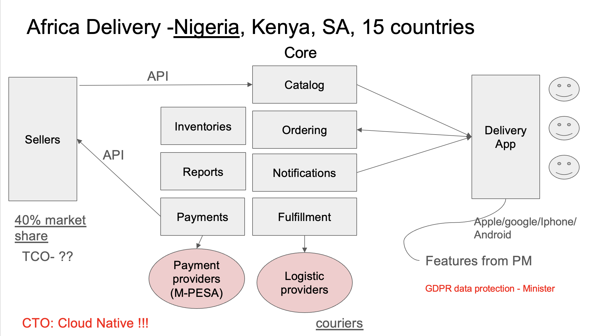
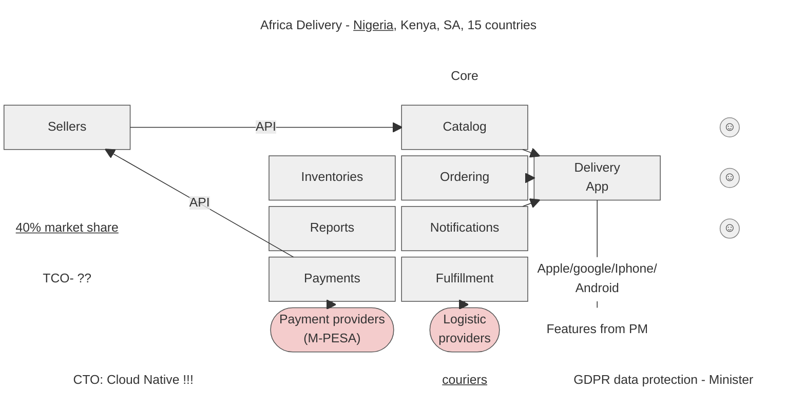

# Артефакт 8. Схема системы

Схему приложения СТО первоначально отрисовал буквально на салфетке.

Однако позже он всё-таки передал её в более читаемом виде.

Та же схема в виде Mermaid-диаграммы:

